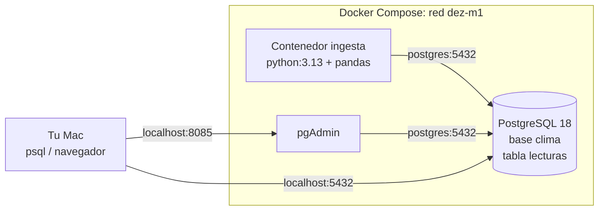

# Módulo 1 · Contenedores con Docker y bases de datos con PostgreSQL

[← LocalCloud](localcloud.md) · [Índice](../../README.md) · [Módulo 2 →](modulo-02-kestra.md)

> **En una frase:** aprendes a empaquetar programas en contenedores y a cargar datos en una base de datos PostgreSQL con un script de Python, todo con un par de comandos.

**Tiempo estimado:** 3 a 4 horas · **Laboratorio:** [`laboratorios/01-docker-postgres`](../../laboratorios/01-docker-postgres/README.md) · **Clasificación:** 🟢 local sin cambios (Terraform: 🔴 requiere GCP)

---

## 1. ¿Qué problema resuelve este módulo?

"**En mi computador funciona**" es la frase más famosa del software. Un script corre en tu Mac, pero falla en el de tu colega porque tiene otra versión de Python, le falta una librería o usa otro sistema operativo.

Docker resuelve eso: empaqueta el programa **junto con todo lo que necesita** y lo ejecuta igual en cualquier computador. En ingeniería de datos lo usamos todo el tiempo para levantar bases de datos, orquestadores y motores de procesamiento sin instalarlos a mano.

La segunda mitad del módulo trata de la **ingesta**: tomar datos de un archivo y guardarlos en una base de datos para poder consultarlos con SQL.

## 2. Conceptos clave

### Imagen y contenedor

- Una **imagen** es una "receta congelada": un sistema operativo mínimo, más los programas y librerías necesarios. Por ejemplo, `postgres:18` es la imagen oficial de PostgreSQL versión 18.
- Un **contenedor** es una imagen **en ejecución**. De una misma imagen puedes crear muchos contenedores, igual que de una receta puedes cocinar muchas tortas.

### Dockerfile

Es el archivo de texto con las instrucciones para **construir tu propia imagen**. El del laboratorio dice, en simple: "parte de Python 3.13, instala pandas y SQLAlchemy, copia mi script y ejecútalo".

```dockerfile
FROM python:3.13-slim                 # imagen base
COPY pyproject.toml .                 # copia la lista de librerías
RUN uv pip install --system -r pyproject.toml   # las instala
COPY ingesta.py .                     # copia el script
ENTRYPOINT ["python", "ingesta.py"]   # qué se ejecuta al iniciar
```

### Puertos: cómo entras a un contenedor

Un contenedor está aislado. Para que tu Mac pueda conectarse, **publicas un puerto**: `"127.0.0.1:5432:5432"` significa "lo que llegue al puerto 5432 de mi Mac, llévalo al puerto 5432 del contenedor". El `127.0.0.1` restringe el acceso a tu propio computador.

### Volúmenes: para no perder los datos

Cuando borras un contenedor, se pierde todo lo que tenía dentro. Un **volumen** es un disco aparte que sobrevive: la base de datos guarda sus archivos ahí. Por eso `docker compose down` conserva los datos y `docker compose down -v` los borra.

### Docker Compose: varios contenedores a la vez

En vez de escribir un comando largo por cada contenedor, describes todos en un archivo `docker-compose.yml` y los manejas juntos:

| Comando | Qué hace |
|---|---|
| `docker compose up -d --wait` | Enciende todo en segundo plano y espera a que esté sano |
| `docker compose ps` | Muestra qué está corriendo |
| `docker compose logs postgres` | Muestra los mensajes de un servicio |
| `docker compose run --rm ingesta` | Ejecuta una tarea una vez y borra el contenedor al terminar |
| `docker compose down` | Apaga todo (conserva volúmenes) |

**Red interna:** Compose crea una red privada donde cada servicio se llama por su nombre. Por eso, **dentro** de Docker, la ingesta se conecta a `postgres:5432`. **Desde tu Mac**, en cambio, usas `localhost:5432`. Confundir estos dos es el error más común del módulo, y la tarea oficial pregunta justamente por esto.

### PostgreSQL y pgAdmin

- **PostgreSQL** es una base de datos relacional muy popular: guarda tablas con filas y columnas y se consulta con SQL.
- **pgAdmin** es una página web para explorar PostgreSQL con el mouse.

### Ingesta por trozos (*chunks*)

Un archivo de varios GB no cabe cómodo en memoria. Por eso el script lo lee **de a 1000 filas** (`chunksize=1000`) y las va cargando: la primera vez **reemplaza** la tabla y luego **agrega**. Así puedes repetir la ingesta sin duplicar datos.

## 3. Qué vas a construir



## 4. Cómo ejecutarlo

Sigue el [README del laboratorio](../../laboratorios/01-docker-postgres/README.md). En resumen:

```bash
cd laboratorios/01-docker-postgres
docker compose up -d --wait
docker compose run --rm --build ingesta
docker compose exec -T postgres psql -U estudiante -d clima < consultas.sql
```

## 5. Qué resultado esperar

- La ingesta termina con `Listo: la tabla 'lecturas' tiene 3600 filas`.
- Hay 720 lecturas por estación (5 estaciones × 30 días × 24 horas = 3600).
- **Desierto** es la zona más calurosa (26,7 °C promedio) y **Cordillera** la más fría (8,8 °C).

## 6. Cómo comprobarlo

```bash
docker compose ps
```

Los servicios `postgres` y `pgadmin` deben aparecer como `healthy` o `running`.

```bash
docker compose exec postgres psql -U estudiante -d clima -c "SELECT COUNT(*) FROM lecturas;"
```

Debe responder `3600`. Si vuelves a ejecutar la ingesta, debe seguir en `3600` y no en `7200`: así compruebas que el reemplazo funciona.

## 7. Ejercicio original: dos meses de datos y una tabla nueva

1. Ejecuta la ingesta con **60 días** y en una tabla nueva llamada `lecturas_60d`. El script acepta parámetros: `docker compose run --rm ingesta --dias 60 --tabla lecturas_60d`. ¿Cuántas filas esperas antes de ejecutarlo?
2. Escribe una consulta que muestre, **por estación**, la hora del día (0 a 23) con la temperatura promedio más alta. Pista: `EXTRACT(HOUR FROM medido_en)`.
3. **Pregunta de red:** si quisieras que la ingesta se conecte a la base desde **tu Mac**, sin Docker, ¿qué valores de `PG_HOST` y `PG_PORT` usarías? ¿Y desde otro contenedor de la misma red de Compose?

<details>
<summary>Ver solución</summary>

1. 5 estaciones × 60 días × 24 horas = **7200 filas**.

2. Consulta:

```sql
WITH por_hora AS (
  SELECT estacion_id, EXTRACT(HOUR FROM medido_en) AS hora, AVG(temperatura_c) AS t
  FROM lecturas_60d GROUP BY estacion_id, hora
)
SELECT DISTINCT ON (estacion_id) estacion_id, hora, ROUND(t::numeric, 1) AS temp_prom
FROM por_hora ORDER BY estacion_id, t DESC;
```

El generador pone el máximo de calor cerca de las 15:00, así que deberías ver horas cercanas a 15.

3. Desde tu Mac: `PG_HOST=localhost` y `PG_PORT=5432`, el puerto publicado. Desde otro contenedor de la misma red: `PG_HOST=postgres` y `PG_PORT=5432`, el nombre del servicio y el puerto interno.

</details>

## 8. Clasificación de los ejercicios oficiales

[Tarea oficial 2026](https://github.com/DataTalksClub/data-engineering-zoomcamp/blob/a66ad5da2598d7ac147b37eec29632c93f4b1d9d/cohorts/2026/01-docker-terraform/homework.md): usa viajes reales de taxis verdes de Nueva York de noviembre de 2025.

| Pregunta oficial | Clasificación | Nota |
|---|---|---|
| Q1 · Versión de `pip` en `python:3.13` | 🟢 Local sin cambios | `docker run --rm python:3.13 pip --version` |
| Q2 · Red de Docker Compose (host y puerto) | 🟢 Local sin cambios | Explicado en la sección 2 |
| Q3–Q6 · SQL sobre taxis verdes | 🟢 Local sin cambios | Descarga los archivos públicos que indica la tarea y cárgalos en este PostgreSQL, adaptando `ingesta.py` para leer Parquet con `pd.read_parquet` |
| Q7 · Flujo de Terraform | 🔴 Requiere GCP | Ver el [apéndice opcional](apendice-gcp.md). La pregunta es conceptual (`init`, `apply -auto-approve`, `destroy`) y se puede responder leyendo la sección de Terraform del apéndice |

## 9. Material oficial (en inglés)

- [Introducción al curso](https://www.youtube.com/watch?v=JgspdlKXS-w)
- [Taller de Docker y PostgreSQL](https://www.youtube.com/watch?v=lP8xXebHmuE)
- [Repaso de SQL](https://www.youtube.com/watch?v=QEcps_iskgg)
- [Introducción a GCP](https://youtu.be/18jIzE41fJ4) · [Terraform: primeros pasos](https://youtu.be/s2bOYDCKl_M) · [Terraform básico](https://youtu.be/Y2ux7gq3Z0o) · [Terraform con variables](https://youtu.be/PBi0hHjLftk) (requieren GCP)
- [README del módulo 1 (versión 2026)](https://github.com/DataTalksClub/data-engineering-zoomcamp/tree/a66ad5da2598d7ac147b37eec29632c93f4b1d9d/01-docker-terraform)
- [Pipeline oficial con Docker](https://github.com/DataTalksClub/data-engineering-zoomcamp/tree/a66ad5da2598d7ac147b37eec29632c93f4b1d9d/01-docker-terraform/docker-sql/pipeline)

## 10. Errores frecuentes

| Mensaje | Qué significa | Qué hacer |
|---|---|---|
| `Cannot connect to the Docker daemon` | Docker Desktop está cerrado | Ábrelo y espera |
| `port is already allocated` | Otro programa usa ese puerto | `docker ps` para ver qué es, o cambia el puerto publicado |
| `could not translate host name "postgres"` | Ejecutaste el script fuera de Docker | Desde tu Mac usa `localhost` |
| `password authentication failed` | Cambiaste la clave después de crear el volumen | `docker compose down -v` y vuelve a encender. **Ojo:** borra los datos |

[← LocalCloud](localcloud.md) · [Índice](../../README.md) · [Módulo 2 →](modulo-02-kestra.md)
