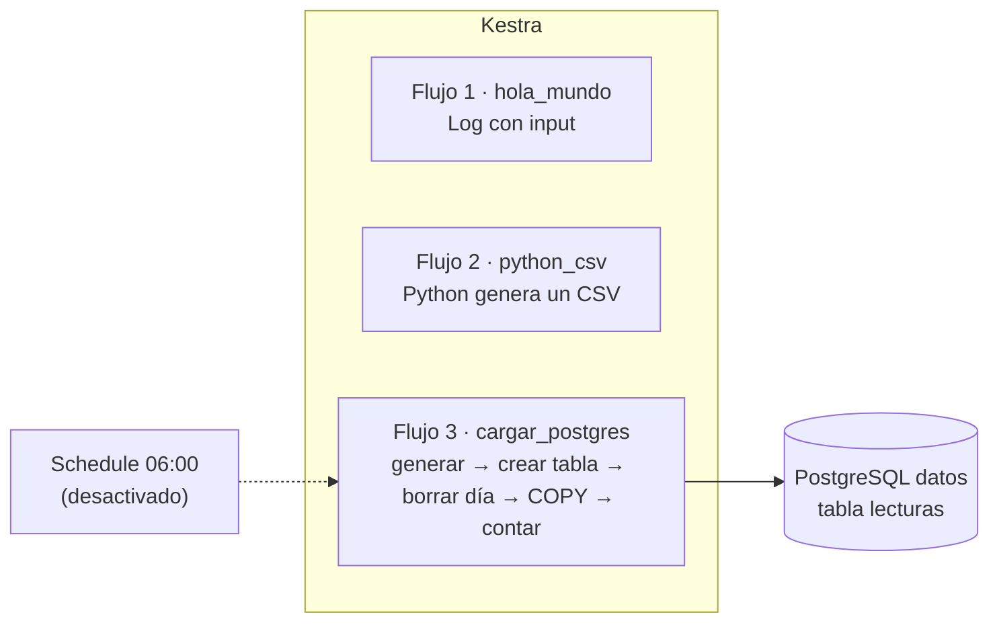

# Módulo 2 · Orquestación de flujos de trabajo con Kestra

[← Módulo 1](modulo-01-docker-postgres.md) · [Índice](../../README.es.md) · [Taller dlt →](taller-dlt.md)

> **En una frase:** aprendes a poner tus scripts de datos "en piloto automático": que corran en orden, a la hora correcta, que se puedan repetir sin duplicar datos y que te avisen si algo falla.

**Tiempo estimado:** 3 a 4 horas · **Laboratorio:** [`laboratorios/02-kestra`](../../laboratorios/02-kestra/README.md) · **Clasificación:** 🟢 local sin cambios (flujos de GCP y de IA: 🔴)

---

## 1. ¿Qué problema resuelve este módulo?

En el módulo 1 ejecutaste la ingesta **a mano**. En la vida real necesitas que:

- corra **todos los días a las 6:00**, aunque estés durmiendo;
- los pasos vayan **en orden**: primero descargar, después limpiar y al final cargar;
- si un paso falla, **se reintente** o te avise;
- puedas **re-ejecutar** un día específico que salió mal;
- puedas **ver** qué corrió, cuándo y con qué resultado.

Hacer eso con alarmas de tu computador y scripts sueltos se vuelve inmanejable muy rápido. Un **orquestador** es el "director de orquesta" que coordina todo. En el curso se usa **Kestra**.

## 2. Conceptos clave

### Flujo (*flow*) y tareas (*tasks*)

Un **flujo** es una receta escrita en un archivo YAML. Tiene una lista de **tareas** que se ejecutan en orden. Cada tarea hace una cosa: escribir un mensaje, ejecutar Python, correr SQL o copiar un archivo.

```yaml
id: hola_mundo           # nombre único del flujo
namespace: dez.es.m2     # "carpeta" donde vive, para ordenar flujos
tasks:
  - id: saludar          # nombre de la tarea
    type: io.kestra.plugin.core.log.Log   # qué tipo de tarea es (un plugin)
    message: "¡Hola!"
```

Así se lee el YAML:

- `clave: valor` asigna un valor.
- La sangría (espacios al inicio) indica qué está dentro de qué.
- Un `-` inicia un elemento de una lista.

### Ejecución (*execution*)

Cada vez que corre un flujo se crea una **ejecución**, con su propio registro: cuándo empezó, qué tareas pasaron y cuáles fallaron. Los estados más comunes son `RUNNING`, `SUCCESS` y `FAILED`.

### Entradas (*inputs*), salidas (*outputs*) y variables

- Los **inputs** son parámetros que eliges al ejecutar, por ejemplo la `fecha` a cargar.
- Los **outputs** son lo que produce una tarea, como un archivo CSV, y pueden usarse en la siguiente: `{{ outputs.generar_csv.outputFiles['lecturas.csv'] }}`.
- Lo que va entre `{{ }}` es una **expresión**: Kestra la reemplaza por un valor al ejecutar.

### Disparadores (*triggers*) y programación

Un **trigger** inicia el flujo automáticamente. El más común es `Schedule`, que usa una expresión **cron** para decir cuándo:

```text
┌──────── minuto (0)
│ ┌────── hora (6)
│ │ ┌──── día del mes (* = todos)
│ │ │ ┌── mes (* = todos)
│ │ │ │ ┌ día de la semana (* = todos)
0 6 * * *      → todos los días a las 06:00
```

### Backfill: rellenar el pasado

Si tu flujo diario empieza hoy, pero necesitas los datos de todo el año pasado, haces un **backfill**: le pides a Kestra que ejecute el flujo **como si** hubiera corrido en cada una de esas fechas. Por eso el flujo usa `trigger.date`, la fecha "programada", en lugar de la fecha de hoy.

### Idempotencia: poder repetir sin miedo

Un flujo es **idempotente** si ejecutarlo dos veces para el mismo día deja el mismo resultado que ejecutarlo una vez. El flujo 3 del laboratorio lo logra **borrando primero** las filas de ese día y **luego** cargándolas. Sin esto, cada reintento duplicaría datos.

### ETL vs ELT

- **ETL** (*Extract, Transform, Load*): limpias los datos **antes** de cargarlos. Es lo que hace el flujo 3.
- **ELT** (*Extract, Load, Transform*): cargas los datos crudos y los transformas **dentro** del data warehouse. Es lo habitual con BigQuery y dbt (módulos 3 y 4).

## 3. Qué vas a construir



Los tres flujos son originales y están comentados en español, en [`laboratorios/02-kestra/flows/`](../../laboratorios/02-kestra/flows/).

## 4. Cómo ejecutarlo

Detalle en el [README del laboratorio](../../laboratorios/02-kestra/README.md):

```bash
cd laboratorios/02-kestra
docker compose up -d
./cargar_flujos.sh
./probar.sh
```

Luego abre <http://localhost:8080> e inicia sesión con las credenciales **de práctica** de `.env.example`. Ahí verás los flujos, las ejecuciones, los logs y un diagrama de cada flujo (pestaña *Topology*).

## 5. Qué resultado esperar

- `probar.sh` ejecuta los tres flujos y termina con `LABORATORIO KESTRA OK ✅`.
- El flujo 3 carga **144 lecturas por día** (una cada 10 minutos).
- Ejecuta dos veces el mismo día y la tabla sigue con 144 filas para ese día, no 288. Esa es la idempotencia en acción.

## 6. Cómo comprobarlo

1. En la interfaz web, menú *Executions*: todas en verde (`SUCCESS`).
2. En los logs de `cargar_postgres` debe aparecer `Cargadas 144 lecturas para el 2024-01-01.`
3. Directo en la base de datos:

```bash
docker compose exec datos_postgres psql -U datos -d sensores -c "SELECT medido_en::date AS dia, COUNT(*) FROM lecturas GROUP BY 1 ORDER BY 1;"
```

## 7. Ejercicio original: un backfill de una semana

1. En la interfaz, abre el flujo `cargar_postgres` y, en la pestaña *Triggers*, usa **Backfill executions** para el rango del **2024-02-01** al **2024-02-07**. Si tu versión de Kestra no muestra el botón, ejecuta el flujo 7 veces a mano, cambiando el input `fecha`.
2. Antes de mirar, calcula: ¿cuántas filas debería haber para ese rango?
3. Vuelve a lanzar el backfill del mismo rango. ¿Cambió el total? ¿Por qué?
4. **Desafío:** agrega al flujo una tarea final que falle si la cantidad de filas del día es distinta de 144. Pista: busca la tarea `io.kestra.plugin.core.execution.Fail` con la propiedad `condition`.

<details>
<summary>Ver solución</summary>

2. 7 días × 144 = **1008 filas**.
3. No cambia: la tarea `borrar_dia` elimina las filas del día antes de volver a cargarlas.
4. Una forma de hacerlo:

```yaml
  - id: validar
    type: io.kestra.plugin.core.execution.Fail
    condition: "{{ outputs.contar.row.filas != 144 }}"
    errorMessage: "Se esperaban 144 filas y llegaron {{ outputs.contar.row.filas }}"
```

> El backfill desde la interfaz no se probó automáticamente al preparar esta ruta. La ejecución manual con distintas fechas sí se probó.

</details>

## 8. Clasificación de los ejercicios oficiales

[Tarea oficial 2026](https://github.com/DataTalksClub/data-engineering-zoomcamp/blob/a66ad5da2598d7ac147b37eec29632c93f4b1d9d/cohorts/2026/02-workflow-orchestration/homework.md): extender los flujos para cargar los CSV de taxis amarillos y verdes de 2021.

| Parte oficial | Clasificación | Nota |
|---|---|---|
| Flujos 01–05 (hola mundo, Python, Postgres, scheduling) | 🟢 Local sin cambios | Usa el [compose oficial](https://github.com/DataTalksClub/data-engineering-zoomcamp/blob/a66ad5da2598d7ac147b37eec29632c93f4b1d9d/02-workflow-orchestration/docker-compose.yml) o este laboratorio. Necesita internet para descargar los CSV públicos |
| Preguntas de la tarea (tamaños, filas, timezone) | 🟢 Local sin cambios | Se responden con los flujos de Postgres |
| Flujos 06–09 (GCS y BigQuery) | 🔴 Requiere GCP | Los plugins de GCP de Kestra apuntan a Google real. Para practicar ELT en local usa el [laboratorio del módulo 3](modulo-03-data-warehouse-bigquery.md) |
| Flujos 10–11 (IA con Gemini y RAG) | 🔴 Requiere una clave de la API de Gemini | Opcional; no forma parte de la ruta local |
| Despliegue en la nube (2.6) | 🔴 Requiere GCP | Ver el [apéndice](apendice-gcp.md) |

## 9. Material oficial (en inglés)

- [Lista de videos del módulo 2 (Kestra)](https://go.kestra.io/de-zoomcamp/yt-playlist)
- [¿Qué es la orquestación?](https://youtu.be/-JLnp-iLins) · [¿Qué es Kestra?](https://youtu.be/ZvVN_NmB_1s) · [Instalar Kestra](https://youtu.be/wgPxC4UjoLM) · [Conceptos de Kestra](https://youtu.be/MNOKVx8780E)
- [Orquestar código Python](https://youtu.be/VAHm0R_XjqI) · [ETL con Postgres](https://youtu.be/-KmwrCqRhic) · [Cargar taxis a Postgres](https://youtu.be/Z9ZmmwtXDcU) · [Scheduling y backfills](https://youtu.be/1pu_C_oOAMA)
- [ETL vs ELT](https://youtu.be/E04yurp1tSU)
- [README del módulo 2 (versión 2026)](https://github.com/DataTalksClub/data-engineering-zoomcamp/tree/a66ad5da2598d7ac147b37eec29632c93f4b1d9d/02-workflow-orchestration)
- [Documentación de Kestra](https://kestra.io/docs)

## 10. Errores frecuentes

| Problema | Solución |
|---|---|
| `cargar_flujos.sh` espera mucho | La primera vez se descarga cerca de 1 GB de imágenes. El script espera hasta 5 minutos |
| `401 Unauthorized` | Revisa usuario y clave. El usuario debe tener formato de email |
| La tarea de Postgres no conecta | Dentro de Docker, la base es `datos_postgres:5432`. Desde tu Mac es `localhost:5434` |
| El Schedule no se ejecuta | Está desactivado a propósito (`disabled: true`). Cámbialo a `false` y vuelve a cargar el flujo |

[← Módulo 1](modulo-01-docker-postgres.md) · [Índice](../../README.es.md) · [Taller dlt →](taller-dlt.md)
