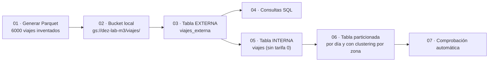

# Módulo 3 · Data warehouse con BigQuery (en local con LocalCloud)

[← Taller dlt](taller-dlt.md) · [Índice](../../README.es.md) · [Módulo 4 →](modulo-04-dbt-duckdb.md)

> **En una frase:** vas a guardar datos en un "lago" (un bucket), consultarlos con SQL desde un "almacén" (BigQuery) y aprender a organizar las tablas para que las consultas lean menos datos.

**Tiempo estimado:** 2 a 3 horas · **Laboratorio:** [`laboratorios/03-bigquery-parquet`](../../laboratorios/03-bigquery-parquet/README.md) · **Clasificación:** 🟡 adaptado a local

---

## 1. ¿Qué problema resuelve este módulo?

Imagina que trabajas en una empresa de transporte. Cada viaje genera una fila con su hora, su origen y su tarifa. Al año son **cientos de millones de filas**. Necesitas responder preguntas como "¿cuánto facturamos en marzo en la zona Centro?".

- Una base de datos "normal" como PostgreSQL (módulo 1) está pensada para **guardar y modificar** registros de a uno: una venta, un usuario nuevo. Si le pides sumar millones de filas, se pone lenta.
- Un **data warehouse** (almacén de datos) está pensado para lo contrario: **leer y resumir** enormes cantidades de datos, muy rápido.

BigQuery es el data warehouse de Google Cloud. En el curso oficial se usa en la nube real. Aquí lo usamos **emulado** en tu Mac con [LocalCloud](localcloud.md): aprendes los mismos conceptos y el mismo SQL sin cuenta ni facturación.

## 2. Conceptos clave, explicados sin jerga

### OLTP vs OLAP

| | OLTP (transaccional) | OLAP (analítico) |
|---|---|---|
| Para qué | Registrar operaciones del día a día | Analizar la historia y sacar conclusiones |
| Ejemplo | "Guardar este viaje" | "Ingresos por zona del último trimestre" |
| Consultas típicas | Muchas, pequeñas, que modifican pocas filas | Pocas, grandes, que leen millones de filas |
| Herramienta del curso | PostgreSQL | BigQuery |

### Data lake (lago) y data warehouse (almacén)

- **Data lake:** un lugar donde guardas **archivos** tal como llegan (CSV, Parquet, JSON). Es barato y flexible, como una bodega con cajas. En Google Cloud es **Cloud Storage** y cada "bodega" se llama **bucket**. Una dirección de archivo se ve así: `gs://mi-bucket/carpeta/archivo.parquet`.
- **Data warehouse:** un lugar donde los datos están organizados en **tablas** listas para consultar con SQL. Es como una biblioteca con estantes ordenados. En Google Cloud es **BigQuery**.

En BigQuery, las tablas viven dentro de un **dataset**, que es como una carpeta de tablas. A su vez, los datasets viven dentro de un **proyecto**. El nombre completo de una tabla es `proyecto.dataset.tabla`. En este laboratorio verás, por ejemplo, `local-gcp-project.lab_m3.viajes`.

### Parquet: un formato "por columnas"

Un CSV guarda los datos **fila por fila**. Parquet los guarda **columna por columna**, comprimidos.

```text
CSV (por filas)                     Parquet (por columnas)
1, 2024-01-03, Centro, 12.5         viaje_id:    1, 2, 3, ...
2, 2024-01-03, Norte,   8.0         inicio:      2024-01-03, 2024-01-03, ...
3, 2024-01-04, Centro, 15.1         zona_origen: Centro, Norte, Centro, ...
                                    tarifa:      12.5, 8.0, 15.1, ...
```

¿Por qué importa? Si tu pregunta solo usa `tarifa`, un sistema por columnas lee **solo esa columna** y se salta el resto. BigQuery almacena sus tablas internas de la misma forma (almacenamiento columnar). Por eso **elegir pocas columnas abarata las consultas**, y `SELECT *` es mala idea en tablas grandes.

### Tabla externa vs tabla interna (materializada)

- **Tabla externa:** BigQuery **no copia** los datos. Guarda solo la "dirección" de los archivos en el bucket y los lee **cada vez** que consultas. Es útil para explorar rápido, pero si alguien borra el archivo, la tabla queda vacía.
- **Tabla interna** (nativa o materializada): BigQuery **copia** los datos a su propio almacenamiento columnar y optimizado. Las consultas son más rápidas y BigQuery conoce de antemano cuánto pesan los datos.

"**Materializar**" significa justamente eso: guardar el resultado de una consulta como una tabla real, en vez de recalcularlo cada vez. En SQL se hace con `CREATE TABLE ... AS SELECT ...`, conocido como **CTAS**.

### Particionamiento: dividir la tabla en cajones

Piensa en una cajonera con **un cajón por día**. Si preguntas por la primera semana de febrero, solo abres 7 cajones y no los 91. Eso es **particionar**: BigQuery divide la tabla según una columna de fecha y, si tu consulta filtra por esa columna, **se salta los cajones que no necesita**. Esto se llama *partition pruning* o **poda de particiones**.

```sql
CREATE TABLE ... PARTITION BY DATE(inicio) AS SELECT ...
```

Buenas prácticas:

- Particiona por la columna de fecha con la que **más filtras**.
- No particiones por algo que genere miles de cajones diminutos. BigQuery tiene un límite de particiones por tabla, y los cajones muy pequeños no ayudan.

### Clustering: ordenar dentro de cada cajón

Dentro de cada cajón, el **clustering** ordena las filas por una o más columnas, por ejemplo `zona_origen`. Si filtras por `zona_origen = 'Centro'`, BigQuery encuentra rápido el tramo que le sirve y lee menos.

```sql
CREATE TABLE ... PARTITION BY DATE(inicio) CLUSTER BY zona_origen AS SELECT ...
```

| | Particionamiento | Clustering |
|---|---|---|
| Analogía | Un cajón por día | Carpetas ordenadas alfabéticamente dentro del cajón |
| Columnas | 1 (fecha, entero o momento de carga) | Hasta 4 |
| Se sabe el costo antes de consultar | Sí, la estimación ya descuenta los cajones | No del todo: el ahorro se ve al ejecutar |
| Úsalo cuando | Filtras siempre por fecha | Filtras o agrupas por columnas con muchos valores distintos |

### Estimación de bytes (*dry run*)

En BigQuery real **pagas según los bytes que lee tu consulta**. Por eso existe el *dry run*: le pides que **estime** cuántos bytes leería, **sin ejecutarla**. En la consola web aparece como "This query will process X MB".

> ⚠️ **Muy importante en esta ruta:** el emulador también responde un *dry run*, pero **sus cifras no son las de BigQuery real**. En nuestras pruebas, el emulador no descuenta las particiones podadas al estimar. Usa el laboratorio para aprender **cómo** se pide la estimación y **cómo** se diseña la tabla. Para comparar números reales necesitas GCP; revisa el [apéndice opcional](apendice-gcp.md).

## 3. Qué vas a construir



Todo ocurre dentro de tu Mac. Las librerías oficiales de Google (`google-cloud-storage` y `google-cloud-bigquery`) apuntan a LocalCloud mediante endpoints locales.

## 4. Cómo ejecutarlo

Los pasos detallados están en el [README del laboratorio](../../laboratorios/03-bigquery-parquet/README.md). En resumen, desde la raíz del repositorio:

```bash
docker compose -f laboratorios/localcloud/docker-compose.yml up -d --wait
```

```bash
cd laboratorios/03-bigquery-parquet && ./ejecutar_lab.sh
```

Te recomiendo correr los pasos **uno por uno** la primera vez y abrir cada archivo de `lab/` para leer los comentarios. Cada script imprime el SQL que envía, para que veas exactamente qué se le pide a BigQuery.

### Cómo se conecta Python a BigQuery "local"

Este es el corazón del truco y está en `lab/comun.py`:

```python
from google.auth.credentials import AnonymousCredentials
from google.cloud import bigquery

bq = bigquery.Client(
    project="local-gcp-project",                              # proyecto que crea LocalCloud
    credentials=AnonymousCredentials(),                       # sin usuario ni clave
    client_options={"api_endpoint": "http://localhost:5388"}, # BigQuery de LocalCloud
)
```

Es **el mismo cliente** que usarías con BigQuery real. Solo cambian el endpoint y las credenciales.

## 5. Qué resultado esperar

Como los datos usan una semilla fija, debes obtener **exactamente**:

| Pregunta | Resultado |
|---|---|
| Viajes en la tabla externa | 6000 |
| Zona con más viajes | Centro (1771) |
| Viajes con tarifa 0 | 60 |
| Filas en la tabla interna | 5940 |
| Particiones diarias | 91 |
| Particiones que necesita una consulta de 1 semana | 7 de 91 (8,2 % de las filas) |

Y al final: `LABORATORIO OK ✅`.

## 6. Cómo comprobarlo

1. **Automático:** `uv run python lab/07_comprobar.py` compara tus Parquet locales con las tablas de BigQuery local.
2. **Visual:** abre <http://localhost:5380/> (consola de LocalCloud) y busca el bucket `dez-lab-m3` y el dataset `lab_m3`.
3. **Con tus propias consultas:** copia este fragmento en un archivo `mi_consulta.py` dentro de la carpeta del laboratorio y ejecútalo con `uv run python mi_consulta.py`:

```python
import sys; sys.path.insert(0, "lab")
from comun import clientes
bq, _ = clientes()
for fila in bq.query("SELECT tipo_pago, COUNT(*) n FROM lab_m3.viajes GROUP BY tipo_pago").result():
    print(dict(fila.items()))
```

## 7. Ejercicio original: ¿cuánto ahorraría la partición?

**Contexto:** el equipo de finanzas consulta **todos los días** los ingresos de la **última semana** en las zonas **Aeropuerto** y **Puerto**.

1. Escribe la consulta que suma `tarifa + propina` entre el `2024-03-25` y el `2024-03-31` para esas dos zonas, usando `lab_m3.viajes_particionada`.
2. Calcula con `INFORMATION_SCHEMA.PARTITIONS` qué porcentaje de las filas está en esas 7 particiones. Ese porcentaje es una aproximación de lo que BigQuery real dejaría de leer gracias a la poda.
3. Pide un *dry run* de tu consulta sobre `viajes` y sobre `viajes_particionada`. ¿Cambia la estimación del emulador? Explica con tus palabras por qué **no** debes sacar conclusiones de costo con esas cifras.
4. **Diseño:** si finanzas también filtrara siempre por `tipo_pago`, ¿lo agregarías al `CLUSTER BY`? ¿En qué orden pondrías las columnas?

<details>
<summary>Ver una solución posible</summary>

```sql
-- 1. Ingresos de la última semana en Aeropuerto y Puerto
SELECT zona_origen, ROUND(SUM(tarifa + propina), 2) AS ingresos
FROM `local-gcp-project.lab_m3.viajes_particionada`
WHERE DATE(inicio) BETWEEN '2024-03-25' AND '2024-03-31'
  AND zona_origen IN ('Aeropuerto', 'Puerto')
GROUP BY zona_origen;

-- 2. Porcentaje de filas en esas particiones
SELECT
  SUM(IF(partition_id BETWEEN '20240325' AND '20240331', total_rows, 0)) AS filas_semana,
  SUM(total_rows) AS filas_total,
  ROUND(100 * SUM(IF(partition_id BETWEEN '20240325' AND '20240331', total_rows, 0)) / SUM(total_rows), 1) AS pct
FROM `local-gcp-project.lab_m3.INFORMATION_SCHEMA.PARTITIONS`
WHERE table_name = 'viajes_particionada';
```

Resultados esperados: Aeropuerto `493.78` y Puerto `357.07`. Las 7 particiones suman `456` de `5940` filas, es decir, `7.7 %`.

3. Para el *dry run*, usa `bigquery.QueryJobConfig(dry_run=True, use_query_cache=False)`, como en `lab/06_particion_y_clustering.py`. En nuestras pruebas, el emulador estimó **193.555 bytes en ambas tablas**, porque no simula la poda al estimar. Las cifras de costo solo valen en BigQuery real.

4. Sí, tiene sentido: `CLUSTER BY zona_origen, tipo_pago`. El orden importa: primero la columna por la que **más** filtras.

</details>

## 8. Clasificación de los ejercicios oficiales

La [tarea oficial 2026](https://github.com/DataTalksClub/data-engineering-zoomcamp/blob/a66ad5da2598d7ac147b37eec29632c93f4b1d9d/cohorts/2026/03-data-warehouse/homework.md) usa viajes reales de taxis amarillos de Nueva York, de enero a junio de 2024.

| Pregunta oficial | Clasificación | Cómo hacerla en esta ruta |
|---|---|---|
| Q1 · Contar registros | 🟡 Adaptado a local | Sube los 6 Parquet al bucket local con el patrón del paso 02 y cuenta en la tabla externa. Son unos 20 millones de filas: puede tardar y requiere memoria (no probado a esa escala). Alternativa liviana: DuckDB con `read_parquet`. |
| Q2 · Estimación de bytes externa vs materializada | 🔴 Requiere GCP | Las cifras del emulador no son las de BigQuery. Aprende el concepto con el paso 06. |
| Q3 · Almacenamiento columnar | 🟢 Local sin cambios | Es conceptual: está explicado en la sección 2. |
| Q4 · Viajes con tarifa 0 | 🟡 Adaptado a local | Igual que Q1, con `WHERE fare_amount = 0`. |
| Q5 · Estrategia de partición y clustering | 🟢 Local sin cambios | El DDL `PARTITION BY` y `CLUSTER BY` funciona igual en LocalCloud. |
| Q6 · Beneficio de la partición (MB) | 🔴 Requiere GCP | Requiere cifras reales. Localmente calcula el % de particiones con `INFORMATION_SCHEMA.PARTITIONS`. |
| Q7 · Dónde viven los datos de una tabla externa | 🟢 Local sin cambios | Conceptual: en el bucket. |
| Q8 · Buenas prácticas de clustering | 🟢 Local sin cambios | Conceptual. |
| Q9 · Bytes de `SELECT COUNT(*)` | 🔴 Requiere GCP | Depende de metadatos y de la facturación de BigQuery real. |
| BigQuery ML (videos 3.3.x) | 🔴 Requiere GCP | El emulador solo ofrece ML en su imagen "full", que no se probó en esta ruta. |

## 9. Material oficial (en inglés)

Videos del curso 2026:

- [Data Warehouse y BigQuery](https://youtu.be/jrHljAoD6nM)
- [Particionamiento y clustering](https://youtu.be/-CqXf7vhhDs)
- [Buenas prácticas de BigQuery](https://youtu.be/k81mLJVX08w)
- [Cómo funciona BigQuery por dentro](https://youtu.be/eduHi1inM4s)
- [Machine Learning en BigQuery](https://youtu.be/B-WtpB0PuG4) (requiere GCP)
- [Desplegar un modelo de ML](https://youtu.be/BjARzEWaznU) (requiere GCP)

Material escrito:

- [README del módulo 3 (versión 2026)](https://github.com/DataTalksClub/data-engineering-zoomcamp/tree/a66ad5da2598d7ac147b37eec29632c93f4b1d9d/03-data-warehouse)
- [SQL de ejemplo `big_query.sql`](https://github.com/DataTalksClub/data-engineering-zoomcamp/blob/a66ad5da2598d7ac147b37eec29632c93f4b1d9d/03-data-warehouse/big_query.sql)
- [Tarea 2026](https://github.com/DataTalksClub/data-engineering-zoomcamp/blob/a66ad5da2598d7ac147b37eec29632c93f4b1d9d/cohorts/2026/03-data-warehouse/homework.md)
- [Documentación de BigQuery en LocalCloud](https://local.cloud/services/bigquery/)

## 10. Errores frecuentes

| Mensaje | Qué significa | Qué hacer |
|---|---|---|
| `No pude hablar con LocalCloud` | El emulador está apagado | `docker compose -f laboratorios/localcloud/docker-compose.yml up -d --wait` |
| `No matching signature for function FORMAT_TIMESTAMP ... DATETIME` | Tus fechas no tienen zona horaria y BigQuery las leyó como `DATETIME` | Usa `FORMAT_DATETIME` o genera las fechas en UTC, como hace el paso 01 |
| `Not found: Dataset` | Te saltaste el paso 03 | Ejecuta los pasos en orden |
| La tabla externa da 0 filas | El patrón `uris` no coincide con los archivos | Revisa con el paso 02 qué rutas quedaron en el bucket |

[← Taller dlt](taller-dlt.md) · [Índice](../../README.es.md) · [Módulo 4 →](modulo-04-dbt-duckdb.md)
