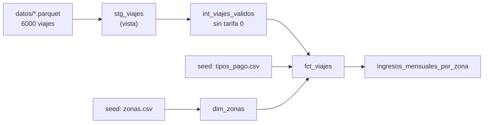

# Módulo 4 · Analytics engineering con dbt y DuckDB

[← Módulo 3](modulo-03-data-warehouse-bigquery.md) · [Índice](../../README.md) · [Módulo 5 →](modulo-05-bruin.md)

> **En una frase:** aprendes a transformar datos crudos en tablas confiables y listas para reportes, escribiendo SQL organizado en capas, con pruebas automáticas y documentación.

**Tiempo estimado:** 4 a 5 horas · **Laboratorio:** [`laboratorios/04-dbt-duckdb`](../../laboratorios/04-dbt-duckdb/README.md) · **Clasificación:** 🟡 adaptado a local (DuckDB en lugar de BigQuery)

---

## 1. ¿Qué problema resuelve este módulo?

Ya sabes cargar datos en un warehouse (módulos 1 a 3). Pero los datos crudos rara vez sirven tal cual: tienen nombres raros, viajes con tarifa 0, códigos en vez de nombres de zona... Alguien tiene que **limpiarlos, unirlos y resumirlos**.

Si cada analista escribe su propio SQL, aparecen 5 versiones distintas de "ingresos del mes", nadie sabe cuál es la buena y un cambio rompe reportes sin que nadie se entere. El **analytics engineering** aplica buenas prácticas de software al SQL de análisis: código ordenado, versionado en git, probado y documentado.

[dbt](https://docs.getdbt.com/) (*data build tool*) es la herramienta estándar para eso.

## 2. Conceptos clave

### Qué hace dbt (y qué no)

dbt **no mueve datos** entre sistemas. Toma datos que **ya están** en tu warehouse y ejecuta `SELECT`s que crean nuevas tablas o vistas **dentro del mismo warehouse**. Es la "T" de ELT.

Cada **modelo** es un archivo `.sql` con un solo `SELECT`. dbt se encarga de envolverlo en `CREATE TABLE ... AS` o `CREATE VIEW ... AS`.

### `ref()` y `source()`: el pegamento entre modelos

```sql
-- models/marts/fct_viajes.sql (simplificado)
SELECT v.viaje_id, v.inicio, v.tarifa, zo.zona_id AS zona_origen_id
FROM {{ ref('int_viajes_validos') }} AS v        -- otro modelo de dbt
LEFT JOIN {{ ref('dim_zonas') }} AS zo ON v.zona_origen = zo.zona
```

- `{{ ref('modelo') }}` apunta a otro modelo. Con eso, dbt sabe **en qué orden** construirlos y dibuja el **linaje**, el diagrama de qué depende de qué.
- `{{ source('crudo', 'viajes') }}` apunta a datos que **no** crea dbt: la materia prima.

### Capas: de lo crudo a lo útil

| Capa | Para qué | Ejemplo en el laboratorio | Se materializa como |
|---|---|---|---|
| **staging** | Renombrar, convertir tipos; 1 modelo por fuente | `stg_viajes` | Vista |
| **intermediate** | Reglas de negocio, filtros, uniones intermedias | `int_viajes_validos` (sin tarifa 0) | Tabla |
| **marts** | Tablas finales para el negocio: hechos y dimensiones | `fct_viajes`, `dim_zonas` | Tabla |
| **reporting** | Agregados listos para un dashboard | `ingresos_mensuales_por_zona` | Tabla |

### Hechos y dimensiones (modelo estrella)

- Una **tabla de hechos** (`fct_`) registra **eventos que se miden**: cada viaje, con su tarifa y su duración.
- Una **tabla de dimensión** (`dim_`) **describe** cosas: cada zona, con su nombre y su tipo.

Se unen por una clave (en el laboratorio, `zona_id`). Dibujado, se ve como una estrella: los hechos al centro y las dimensiones alrededor.

### Seeds, macros y pruebas

- **Seeds:** archivos CSV pequeños que dbt carga como tablas, por ejemplo la lista de zonas. Útiles para catálogos que casi no cambian.
- **Macros:** funciones reutilizables de SQL. Por ejemplo, `duracion_minutos(inicio, fin)` evita repetir el cálculo en varios modelos.
- **Pruebas (*tests*):** reglas que dbt verifica después de construir cada modelo:
  - `unique`: no hay valores repetidos;
  - `not_null`: no hay vacíos;
  - `accepted_values`: solo valores permitidos;
  - `relationships`: cada `zona_id` existe en `dim_zonas`;
  - **singulares**: una consulta tuya que debe devolver 0 filas.

Si una prueba falla, `dbt build` te avisa **antes** de que el error llegue a un reporte.

### dbt Core vs dbt Cloud, BigQuery vs DuckDB

El curso oficial ofrece dos caminos: **BigQuery + dbt Cloud** (en la nube) o **DuckDB + dbt Core** (local). Esta ruta usa el segundo: `dbt-core` con el adaptador `dbt-duckdb`. Los conceptos y el SQL son prácticamente los mismos; cambian la conexión (`profiles.yml`) y algunas funciones de fecha.

## 3. Qué vas a construir



## 4. Cómo ejecutarlo

Pasos completos en el [README del laboratorio](../../laboratorios/04-dbt-duckdb/README.md):

```bash
cd laboratorios/04-dbt-duckdb
uv sync
uv run python generar_datos.py
uv run dbt build --profiles-dir .
```

`dbt build` hace todo en orden: carga los seeds, construye los modelos y ejecuta las pruebas.

## 5. Qué resultado esperar

```text
Done. PASS=24 WARN=0 ERROR=0 SKIP=0 ... TOTAL=24
```

Son 2 seeds, 1 vista, 4 tablas y 17 pruebas. En filas:

| Modelo | Filas |
|---|---|
| `stg_viajes` | 6000 |
| `int_viajes_validos` y `fct_viajes` | 5936 (se quitan 64 viajes con tarifa 0) |
| `ingresos_mensuales_por_zona` | 24 (3 meses × 8 zonas) |

## 6. Cómo comprobarlo

1. `uv run python consultar.py` muestra las filas por capa y el ranking de enero: **Centro** con 563 viajes y 7755.80 de ingresos.
2. Mira el **linaje** en la documentación que genera dbt:

```bash
uv run dbt docs generate --profiles-dir . && uv run dbt docs serve --profiles-dir . --port 8090
```

3. **Rompe algo a propósito:** en `seeds/zonas.csv`, duplica una fila y ejecuta `dbt build`. La prueba `unique` debe fallar. Después deshaz el cambio.

## 7. Ejercicio original

1. Crea `models/marts/reporting/viajes_por_tipo_pago.sql` que muestre, por mes y tipo de pago, la cantidad de viajes y su porcentaje sobre el total del mes.
2. Agrégale pruebas `not_null` y una prueba singular que verifique que los porcentajes de cada mes suman 100, con un margen de 0,1.
3. Ejecuta `uv run dbt build --profiles-dir . --select +viajes_por_tipo_pago`. ¿Qué significa el `+` delante del nombre?

<details>
<summary>Ver una solución posible</summary>

```sql
-- models/marts/reporting/viajes_por_tipo_pago.sql
WITH base AS (
  SELECT DATE_TRUNC('month', inicio) AS mes, tipo_pago, COUNT(*) AS viajes
  FROM {{ ref('fct_viajes') }}
  GROUP BY 1, 2
)
SELECT mes, tipo_pago, viajes,
       ROUND(100.0 * viajes / SUM(viajes) OVER (PARTITION BY mes), 2) AS pct
FROM base
```

```sql
-- tests/assert_porcentajes_suman_100.sql (debe devolver 0 filas)
SELECT mes, SUM(pct) AS total
FROM {{ ref('viajes_por_tipo_pago') }}
GROUP BY mes
HAVING ABS(SUM(pct) - 100) > 0.1
```

El `+` antes del nombre significa "este modelo **y todo lo que necesita antes**", es decir, sus ancestros en el linaje. Un `+` después (`viajes_por_tipo_pago+`) seleccionaría lo que depende de él.

> Esta solución se probó con el laboratorio: `dbt build --select +viajes_por_tipo_pago` terminó con `PASS=23 ERROR=0`.

</details>

## 8. Clasificación de los ejercicios oficiales

[Tarea oficial 2026](https://github.com/DataTalksClub/data-engineering-zoomcamp/blob/a66ad5da2598d7ac147b37eec29632c93f4b1d9d/cohorts/2026/04-analytics-engineering/homework.md): proyecto `taxi_rides_ny` con taxis verdes y amarillos de 2019–2020 y FHV de 2019.

| Parte oficial | Clasificación | Nota |
|---|---|---|
| Configuración con DuckDB + dbt Core ([guía oficial](https://github.com/DataTalksClub/data-engineering-zoomcamp/blob/a66ad5da2598d7ac147b37eec29632c93f4b1d9d/04-analytics-engineering/setup/local_setup.md)) | 🟢 Local sin cambios | Descarga varios GB de datos públicos; revisa la [guía de problemas de memoria](https://github.com/DataTalksClub/data-engineering-zoomcamp/blob/a66ad5da2598d7ac147b37eec29632c93f4b1d9d/04-analytics-engineering/setup/duckdb_troubleshooting.md) |
| Preguntas sobre linaje, pruebas, filas y zonas | 🟢 Local sin cambios | Se responden con el camino DuckDB |
| Configuración con BigQuery + dbt Cloud | 🔴 Requiere GCP | Ver el [apéndice](apendice-gcp.md) |

## 9. Material oficial (en inglés)

- [Introducción al analytics engineering](https://www.youtube.com/watch?v=HxMIsPrIyGQ) · [Modelado de datos](https://www.youtube.com/watch?v=uF76d5EmdtU) · [¿Qué es dbt?](https://www.youtube.com/watch?v=gsKuETFJr54)
- [Configuración local: DuckDB + dbt Core](https://www.youtube.com/watch?v=GoFAbJYfvlw)
- [Estructura del proyecto](https://www.youtube.com/watch?v=2dYDS4OQbT0) · [Fuentes](https://www.youtube.com/watch?v=7CrrXazV_8k) · [Modelos](https://www.youtube.com/watch?v=JQYz-8sl1aQ) · [Seeds y macros](https://www.youtube.com/watch?v=lT4fmTDEqVk) · [Pruebas](https://www.youtube.com/watch?v=bvZ-rJm7uMU) · [Documentación](https://www.youtube.com/watch?v=UqoWyMjcqrA) · [Paquetes](https://www.youtube.com/watch?v=KfhUA9Kfp8Y) · [Comandos](https://www.youtube.com/watch?v=t4OeWHW3SsA)
- [README del módulo 4 (versión 2026)](https://github.com/DataTalksClub/data-engineering-zoomcamp/tree/a66ad5da2598d7ac147b37eec29632c93f4b1d9d/04-analytics-engineering)
- [Documentación de dbt](https://docs.getdbt.com/) · [Adaptador dbt-duckdb](https://github.com/duckdb/dbt-duckdb)

## 10. Errores frecuentes

| Mensaje | Qué hacer |
|---|---|
| `Could not find profile named 'viajes_locales'` | Agrega `--profiles-dir .` o ejecuta desde la carpeta del laboratorio |
| `No files found that match the pattern` | Falta `uv run python generar_datos.py` |
| `Could not set lock on file ... .duckdb` | Otro programa tiene abierto el archivo; ciérralo |
| Totales por mes distintos a los de la guía | Revisa `TimeZone: UTC` en `profiles.yml` |

[← Módulo 3](modulo-03-data-warehouse-bigquery.md) · [Índice](../../README.md) · [Módulo 5 →](modulo-05-bruin.md)
