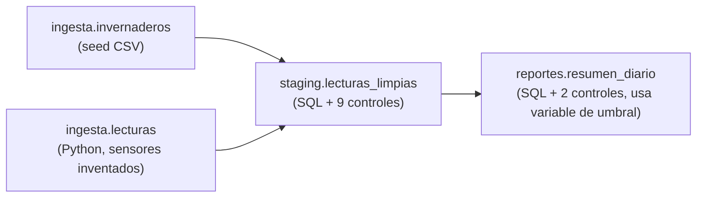

# Módulo 5 · Plataformas de datos con Bruin

[← Módulo 4](modulo-04-dbt-duckdb.md) · [Índice](../../README.es.md) · [Módulo 6 →](modulo-06-pyspark.md)

> **En una frase:** aprendes a reunir en **una sola herramienta** lo que en los módulos anteriores hiciste con varias: ingestar, transformar, controlar la calidad, ver el linaje y programar la ejecución.

**Tiempo estimado:** 2 a 3 horas · **Laboratorio:** [`laboratorios/05-bruin`](../../laboratorios/05-bruin/README.md) · **Clasificación:** 🟢 local sin cambios (Bruin Cloud: opcional)

---

## 1. ¿Qué problema resuelve este módulo?

Hasta ahora usaste una herramienta para cada cosa: `dlt` para ingestar, dbt para transformar, Kestra para orquestar. Funciona, pero cada herramienta tiene su configuración, su forma de declarar dependencias y su forma de reportar errores. Conectarlas requiere trabajo.

Una **plataforma de datos** intenta cubrir todo el ciclo en un mismo lugar. [Bruin](https://getbruin.com/docs/bruin/) es una herramienta de línea de comandos que hace eso:

- ingesta y transformación con **SQL o Python**;
- **controles de calidad** declarados junto al código;
- **linaje** automático;
- **variables** para cambiar el comportamiento sin editar el código.

## 2. Conceptos clave

### Proyecto, pipeline y asset

| Concepto | Qué es | En el laboratorio |
|---|---|---|
| **Proyecto** | La carpeta raíz con el archivo `.bruin.yml`, que guarda las **conexiones** (a qué bases de datos se conecta) | `laboratorios/05-bruin` |
| **Pipeline** | Una carpeta con `pipeline.yml`: nombre, programación y variables | `invernadero/` |
| **Asset** | Cada pieza de datos que el pipeline produce: una tabla, una vista o un archivo. Se define con un archivo `.sql`, `.py` o `.yml` | `staging.lecturas_limpias` |

En dbt, las dependencias se declaran con `ref()`. En Bruin, cada asset declara de qué depende (`depends`) en un bloque de configuración al inicio del archivo. Con eso, Bruin arma el orden de ejecución y el linaje.

### Tipos de asset

- **Seed:** un CSV que se carga como tabla, por ejemplo la lista de invernaderos.
- **Python:** un script que genera o descarga datos. Bruin le entrega las fechas (`BRUIN_START_DATE`, `BRUIN_END_DATE`) y las variables.
- **SQL:** una consulta que crea una tabla o vista en la base de datos, aquí DuckDB.

### Estrategias de materialización

Indican **cómo** se escribe la tabla cada vez que corre el asset:

| Estrategia | Qué hace |
|---|---|
| `create+replace` | Borra la tabla y la crea de nuevo |
| `append` | Agrega filas |
| `time_interval` | Borra y vuelve a escribir **solo el rango de fechas** de la ejecución. Es ideal para reprocesar días sin tocar el resto |

### Controles de calidad (*quality checks*)

Se declaran en la configuración de cada asset, por columna: `not_null`, `unique`, `accepted_values`, `positive`. También puedes escribir **controles propios** en SQL. Si uno falla, Bruin detiene lo que depende de ese asset. Es la misma idea que las pruebas de dbt, pero integrada en la ejecución.

### Variables

Valores definidos en `pipeline.yml`, como `umbral_temperatura_c: 30`, que puedes cambiar al ejecutar con `--var umbral_temperatura_c=28`, sin tocar el código.

## 3. Qué vas a construir



## 4. Cómo ejecutarlo

Sigue el [README del laboratorio](../../laboratorios/05-bruin/README.md). Primero instala la CLI de Bruin; el README explica el método oficial y una alternativa con verificación de checksum. Luego:

```bash
cd laboratorios/05-bruin
export BRUIN_CONFIG_FILE="$PWD/.bruin.yml"
bruin validate invernadero
bruin run --start-date 2024-03-01 --end-date 2024-03-07 invernadero
```

> ⚠️ Bruin busca `.bruin.yml` en la **raíz del repositorio git**. Como este laboratorio vive en una subcarpeta, usa `BRUIN_CONFIG_FILE` o la opción `--config-file .bruin.yml`. Si no lo haces, Bruin crea un archivo vacío en la raíz del repositorio.

## 5. Qué resultado esperar

```text
 ✓ Assets executed      4 succeeded
 ✓ Quality checks       13 succeeded
```

| Dato | Valor |
|---|---|
| Lecturas crudas | 4032 (7 días × 24 h × 4 por hora × 6 sensores) |
| Lecturas limpias | 3931 (se descartan 101 sin temperatura) |
| Filas del reporte | 21 (7 días × 3 invernaderos) |
| Alertas de calor (umbral 30 °C) | 318 |

## 6. Cómo comprobarlo

- La consulta de la sección "Comprobar" del README debe devolver exactamente los números de arriba.
- `bruin lineage --full invernadero/assets/staging/lecturas_limpias.sql` muestra qué assets van antes y después.
- Ejecuta solo el reporte con `--var umbral_temperatura_c=28`: las alertas deben subir a **641**.

## 7. Ejercicio original: un control que falla a propósito

1. Agrega al asset `staging.lecturas_limpias` un control `accepted_values` sobre la columna del invernadero que **no** incluya uno de los 3 invernaderos. Ejecuta el pipeline. ¿Qué pasa con `reportes.resumen_diario`?
2. Corrige el control y vuelve a ejecutar **solo desde staging hacia adelante**. Pista: busca cómo seleccionar un asset y sus dependientes en `bruin run --help`.
3. ¿Qué estrategia de materialización usarías si cada día llegan correcciones de lecturas de los últimos 3 días? Justifica.

<details>
<summary>Ver solución</summary>

1. El control falla, Bruin marca el asset con error y **no ejecuta** el reporte, porque depende de staging. Así se evita publicar un reporte con datos dudosos.
2. `bruin run --downstream invernadero/assets/staging/lecturas_limpias.sql` ejecuta ese asset y todo lo que depende de él. La opción existe en Bruin v0.11.827.
3. `time_interval`: reprocesas solo el rango de los últimos 3 días (`--start-date` / `--end-date`) sin reescribir toda la tabla.

</details>

## 8. Clasificación de los ejercicios oficiales

[Tarea oficial 2026](https://github.com/DataTalksClub/data-engineering-zoomcamp/blob/a66ad5da2598d7ac147b37eec29632c93f4b1d9d/cohorts/2026/05-data-platforms/homework.md): 7 preguntas conceptuales sobre Bruin con el pipeline de taxis (`bruin init zoomcamp`).

| Parte oficial | Clasificación | Nota |
|---|---|---|
| Pipeline de taxis con la plantilla `zoomcamp` y DuckDB | 🟢 Local sin cambios | Descarga archivos públicos de taxis; necesita internet |
| Preguntas sobre archivos, estrategias, variables, selección, controles, linaje y `--full-refresh` | 🟢 Local sin cambios | Este laboratorio practica todos esos conceptos |
| Bruin MCP con agentes de IA | 🟢 Local sin cambios | Opcional; depende de tu editor |
| Bruin Cloud | 🔴 Requiere una cuenta externa | Opcional |

## 9. Material oficial (en inglés)

- [Introducción](https://youtu.be/f6vg7lGqZx0) · [Primeros pasos](https://youtu.be/JJwHKSidX_c) · [Pipeline de taxis de punta a punta](https://youtu.be/q0k_iz9kWsI) · [Bruin MCP](https://youtu.be/224xH7h8OaQ) · [Bruin Cloud](https://youtu.be/uBqjLEwF8rc)
- Conceptos: [Proyectos](https://www.youtube.com/watch?v=YWDjnSxbBtY) · [Pipelines](https://www.youtube.com/watch?v=uzp_DiR4Sok) · [Assets](https://www.youtube.com/watch?v=ZElY5SoqrwI) · [Variables](https://www.youtube.com/watch?v=XCx0nDmhhxA) · [Comandos](https://www.youtube.com/watch?v=3nykPEs_V7E)
- [README del módulo 5 (versión 2026)](https://github.com/DataTalksClub/data-engineering-zoomcamp/tree/a66ad5da2598d7ac147b37eec29632c93f4b1d9d/05-data-platforms)
- [Documentación de Bruin](https://getbruin.com/docs/bruin/)

## 10. Errores frecuentes

| Problema | Qué hacer |
|---|---|
| `bruin: command not found` | Abre una terminal nueva después de instalar, o revisa que `~/.local/bin` esté en tu `PATH` |
| Aparece un `.bruin.yml` en la raíz del repositorio | Bórralo y usa `BRUIN_CONFIG_FILE` como indica la sección 4 |
| La primera ejecución tarda | Bruin descarga Python y sus librerías la primera vez (20 a 60 segundos) |

[← Módulo 4](modulo-04-dbt-duckdb.md) · [Índice](../../README.es.md) · [Módulo 6 →](modulo-06-pyspark.md)
