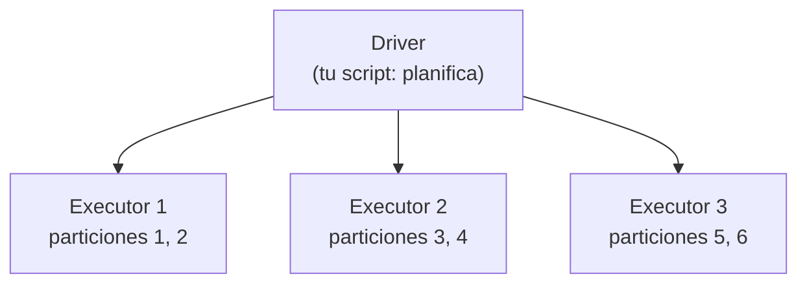
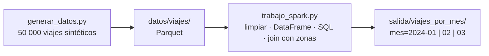

# Módulo 6 · Procesamiento por lotes (batch) con PySpark

[← Módulo 5](modulo-05-bruin.md) · [Índice](../../README.md) · [Módulo 7 →](modulo-07-streaming.md)

> **En una frase:** aprendes a procesar grandes volúmenes de datos repartiendo el trabajo entre muchos núcleos (o máquinas) con Apache Spark, usando Python.

**Tiempo estimado:** 3 a 4 horas · **Laboratorio:** [`laboratorios/06-pyspark`](../../laboratorios/06-pyspark/README.md) · **Clasificación:** 🟢 local sin cambios (GCS, Dataproc y BigQuery: 🔴)

---

## 1. ¿Qué problema resuelve este módulo?

pandas es excelente, pero trabaja en **un solo proceso** y necesita que los datos **quepan en la memoria** de tu computador. ¿Qué haces con 500 GB de viajes?

**Apache Spark** divide los datos en pedazos llamados **particiones** y los procesa **en paralelo**: en los varios núcleos de tu Mac o en cientos de máquinas de un clúster. Tu código es el mismo en ambos casos.

### Batch vs streaming

| | Batch (por lotes) | Streaming (en flujo) |
|---|---|---|
| Cuándo procesa | Cada cierto tiempo: cada hora o cada noche | Apenas llega cada evento |
| Ejemplo | "Calcular las ventas de ayer" | "Detectar un fraude ahora" |
| En el curso | Este módulo (Spark) | Módulo 7 (Flink) |

La mayoría de los pipelines del mundo real son batch: son más simples y más baratos.

## 2. Conceptos clave

### Driver, executors y particiones



- El **driver** es el programa que escribes. No procesa los datos: **planifica** el trabajo.
- Los **executors** hacen el trabajo pesado, cada uno sobre algunas **particiones**.
- En este laboratorio todo corre dentro de un contenedor en "modo local": el driver y los executors comparten tu Mac.

### DataFrame

Es una tabla distribuida, con filas y columnas, muy parecida a la de pandas o a una tabla SQL. Puedes trabajar con ella con **métodos de Python** o con **SQL**, y el resultado es el mismo:

```python
df.filter(df.tarifa > 0).groupBy("mes").count()          # estilo DataFrame
spark.sql("SELECT mes, COUNT(*) FROM viajes WHERE tarifa > 0 GROUP BY mes")  # estilo SQL
```

### Transformaciones y acciones (evaluación perezosa)

- Las **transformaciones** (`filter`, `select`, `groupBy`, `join`) **no ejecutan nada**: solo agregan un paso al plan.
- Las **acciones** (`show`, `count`, `write`) **disparan** la ejecución de todo el plan.

Esto se llama **evaluación perezosa** (*lazy evaluation*). Gracias a ella, Spark puede optimizar el plan completo antes de ejecutarlo, por ejemplo leyendo solo las columnas que usarás.

### Shuffle: por qué `groupBy` y `join` son "caros"

Para agrupar por mes, todas las filas del mismo mes deben terminar en el **mismo executor**. Mover datos entre executors se llama **shuffle**: es la operación más costosa de Spark. Por eso conviene filtrar **antes** de agrupar y, para unir con una tabla pequeña (como la de zonas), usar un *broadcast join*: se envía una copia de la tabla chica a cada executor.

### Escribir particionado

`df.repartition(4).write.partitionBy("mes").parquet("salida/...")` crea **una carpeta por mes** con hasta 4 archivos cada una. Es la misma idea de "cajones" del módulo 3: quien lea solo marzo, abre una sola carpeta.

### Spark UI

Mientras un trabajo corre, Spark publica una página en el puerto **4040** con los *jobs*, *stages* y tareas. Sirve para ver dónde se demora tu trabajo.

## 3. Qué vas a construir



Spark necesita Java. Para no instalarlo en tu Mac, todo corre dentro de la imagen oficial `apache/spark:4.0.1-python3`, que trae Spark 4.0.1, Java 17 y Python, y funciona en Apple Silicon.

## 4. Cómo ejecutarlo

Detalle en el [README del laboratorio](../../laboratorios/06-pyspark/README.md):

```bash
cd laboratorios/06-pyspark
docker compose up -d --wait
docker compose exec spark /opt/spark/bin/spark-submit generar_datos.py
docker compose exec spark /opt/spark/bin/spark-submit trabajo_spark.py
```

`spark-submit` es el comando que envía un script de Python a Spark para que lo ejecute.

## 5. Qué resultado esperar

| Dato | Valor |
|---|---|
| Versión de Spark | 4.0.1 |
| Filas leídas | 50 000 |
| Filas válidas (tarifa > 0) | 49 483 |
| Enero / febrero / marzo 2024 | 16 782 / 15 783 / 16 918 viajes |
| Viajes por tipo de zona (join) | residencial 24 222 · urbana 18 831 · transporte 6 430 |
| Filas releídas desde `salida/` | 49 483 |

## 6. Cómo comprobarlo

```bash
ls salida/viajes_por_mes
```

Debe mostrar `_SUCCESS` y las carpetas `mes=2024-01`, `mes=2024-02` y `mes=2024-03`.

Para mirar la **Spark UI**, ejecuta con pausa y abre <http://localhost:4040> mientras corre:

```bash
docker compose exec -e PAUSA_UI_SEGUNDOS=60 spark /opt/spark/bin/spark-submit trabajo_spark.py
```

## 7. Ejercicio original

1. En `trabajo_spark.py`, calcula para cada zona de origen el **percentil 90 de la distancia**. Pista: `F.percentile_approx("distancia_km", 0.9)`.
2. Escribe la misma consulta en Spark SQL usando la vista temporal que ya crea el script.
3. Cambia `repartition(4)` por `repartition(1)` y vuelve a ejecutar. ¿Cuántos archivos hay ahora en cada carpeta de mes? ¿Cuándo preferirías pocos archivos y cuándo muchos?
4. Abre la Spark UI durante la ejecución: ¿qué *stage* tiene más tareas? ¿Coincide con el número de particiones?

<details>
<summary>Ver solución</summary>

```python
from pyspark.sql import functions as F
(limpios.groupBy("zona_origen")
    .agg(F.percentile_approx("distancia_km", 0.9).alias("p90_km"))
    .orderBy(F.desc("p90_km"))
    .show())
```

```sql
SELECT zona_origen, percentile_approx(distancia_km, 0.9) AS p90_km
FROM viajes GROUP BY zona_origen ORDER BY p90_km DESC
```

En `trabajo_spark.py`, el DataFrame limpio se llama `limpios` y la vista temporal, `viajes`. El script ya usa `F.broadcast(zonas)` en el join con la tabla de zonas.

3. Con `repartition(1)` queda **1 archivo por mes**. Pocos archivos grandes son mejores para leer después, porque cada archivo tiene un costo fijo de apertura. Muchas particiones aprovechan mejor el paralelismo al escribir. En la práctica, se apunta a archivos de entre 100 MB y 1 GB.

</details>

## 8. Clasificación de los ejercicios oficiales

[Tarea oficial 2026](https://github.com/DataTalksClub/data-engineering-zoomcamp/blob/a66ad5da2598d7ac147b37eec29632c93f4b1d9d/cohorts/2026/06-batch/homework.md): taxis amarillos de noviembre de 2025.

| Parte oficial | Clasificación | Nota |
|---|---|---|
| Q1 `spark.version`, Q5 puerto de la Spark UI | 🟢 Local sin cambios | Con este contenedor: 4.0.1 y 4040 |
| Q2–Q4, Q6 (repartición, conteos, viaje más largo, zona menos frecuente) | 🟢 Local sin cambios | Descarga los Parquet públicos de la tarea en `datos/` y adapta `trabajo_spark.py` |
| Spark con Google Cloud Storage (6.6.1) | 🔴 Requiere GCP | El conector de GCS no se probó contra LocalCloud |
| Dataproc (6.6.3) y Spark → BigQuery (6.6.4) | 🔴 Requiere GCP | Ver el [apéndice](apendice-gcp.md) |

## 9. Material oficial (en inglés)

- [Introducción al batch](https://youtu.be/dcHe5Fl3MF8) · [Introducción a Spark](https://youtu.be/FhaqbEOuQ8U) · [Primer vistazo a PySpark](https://youtu.be/r_Sf6fCB40c) · [DataFrames](https://youtu.be/ti3aC1m3rE8) · [SQL con Spark](https://youtu.be/uAlp2VuZZPY)
- [Anatomía de un clúster](https://youtu.be/68CipcZt7ZA) · [GroupBy por dentro](https://youtu.be/9qrDsY_2COo) · [Joins por dentro](https://youtu.be/lu7TrqAWuH4)
- [Spark y GCS](https://youtu.be/Yyz293hBVcQ) · [Dataproc](https://youtu.be/osAiAYahvh8) · [Spark → BigQuery](https://youtu.be/HIm2BOj8C0Q) (requieren GCP)
- [README del módulo 6 (versión 2026)](https://github.com/DataTalksClub/data-engineering-zoomcamp/tree/a66ad5da2598d7ac147b37eec29632c93f4b1d9d/06-batch)
- [Instalación oficial en macOS](https://github.com/DataTalksClub/data-engineering-zoomcamp/blob/a66ad5da2598d7ac147b37eec29632c93f4b1d9d/06-batch/setup/macos.md), por si prefieres instalar Java y PySpark sin Docker

## 10. Errores frecuentes

| Problema | Qué hacer |
|---|---|
| Muchísimas líneas `INFO` y `WARN` | Es normal en Spark. Agrega `2>/dev/null` al final del comando para ver solo el resultado |
| `port is already allocated` en 4040 | Cambia `4040:4040` por `4041:4040` en el compose |
| Aviso de memoria al 95 % | Es inofensivo con estos volúmenes |
| `Path does not exist: datos/viajes` | Falta ejecutar `generar_datos.py` |

[← Módulo 5](modulo-05-bruin.md) · [Índice](../../README.md) · [Módulo 7 →](modulo-07-streaming.md)
