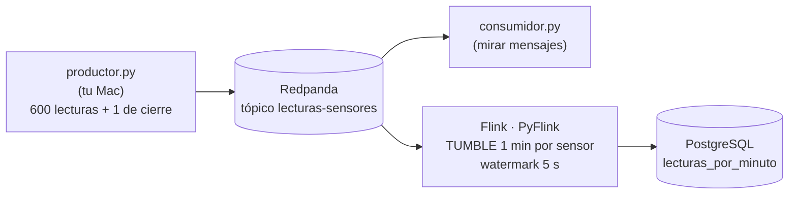

# Módulo 7 · Streaming con Redpanda y PyFlink

[← Módulo 6](modulo-06-pyspark.md) · [Índice](../../README.es.md) · [Proyecto final →](proyecto-final.md)

> **En una frase:** aprendes a procesar datos **mientras llegan**, evento por evento, agrupándolos en ventanas de tiempo y guardando los resultados en una base de datos.

**Tiempo estimado:** 4 a 5 horas · **Laboratorio:** [`laboratorios/07-streaming`](../../laboratorios/07-streaming/README.md) · **Clasificación:** 🟢 local sin cambios

---

## 1. ¿Qué problema resuelve este módulo?

En el módulo 6 procesabas "lo de ayer". Hay casos en que esperar no sirve:

- un sensor de una cámara de frío pasa de 4 °C a 15 °C y hay que avisar **ahora**;
- una tarjeta se usa en dos países en 5 minutos y puede ser fraude;
- un tablero muestra pedidos **en vivo**.

El **streaming** procesa los datos como un flujo continuo. Necesita dos piezas:

1. Un **sistema de mensajería** que reciba y guarde los eventos en orden: **Kafka** o su alternativa compatible, **Redpanda**.
2. Un **motor de procesamiento** que los lea y calcule cosas sobre ellos de forma continua: **Apache Flink**, usado desde Python con **PyFlink**.

## 2. Conceptos clave

### Evento, productor, consumidor, tópico

| Concepto | Qué es | En el laboratorio |
|---|---|---|
| **Evento (mensaje)** | Un hecho que ocurrió, con su hora | `{"sensor_id": "sensor-01", "temperatura": 19.49, "ts": ...}` |
| **Productor** | Programa que **envía** eventos | `scripts/productor.py` |
| **Tópico** | "Canal" o "carpeta" donde se guardan los eventos de un tipo | `lecturas-sensores` |
| **Consumidor** | Programa que **lee** eventos | `scripts/consumidor.py` y el trabajo de Flink |
| **Broker** | El servidor que guarda los tópicos | Redpanda |

A diferencia de una cola de tareas, Kafka y Redpanda **no borran** el mensaje cuando alguien lo lee. Cada consumidor lleva su propia posición, llamada **offset**, y puede releer desde el principio (`earliest`) o empezar desde lo más nuevo (`latest`).

### Particiones del tópico

Un tópico se divide en **particiones** para repartir la carga. El orden de los mensajes se garantiza **dentro** de cada partición. En el laboratorio usamos **1 partición** para que el ejemplo sea predecible. La sección de errores frecuentes explica por qué.

### Tiempo de evento vs tiempo de procesamiento

- **Tiempo de evento:** la hora **en que ocurrió** la lectura (viene dentro del mensaje).
- **Tiempo de procesamiento:** la hora en que Flink **la recibe**.

Pueden ser muy distintos si un sensor pierde conexión y envía todo después. Para calcular "promedio por minuto" correctamente, se usa el **tiempo de evento**.

### Ventanas

Agrupan eventos por tiempo:

```text
TUMBLE (fijas, sin traslape) de 1 min:   |--12:00--|--12:01--|--12:02--|
HOP (deslizantes) de 2 min cada 1 min:   |-----12:00-12:02-----|
                                                   |-----12:01-12:03-----|
SESSION (por inactividad, gap de 5 min): |eventos...|  (5 min sin eventos)  |eventos...|
```

El laboratorio usa **TUMBLE de 1 minuto** por sensor. La tarea oficial también pide ventanas SESSION.

### Watermark: ¿cuándo se "cierra" una ventana?

Flink no puede esperar para siempre por si llega un evento atrasado. El **watermark** es la señal "ya no espero eventos anteriores a esta hora". En el laboratorio:

```sql
WATERMARK FOR evento_ts AS evento_ts - INTERVAL '5' SECOND
```

Significa: "tolero 5 segundos de atraso". Cuando el watermark pasa las 12:01:00, Flink cierra la ventana de 12:00 a 12:01 y escribe su resultado. Los eventos que lleguen después de eso se consideran **tardíos** y se descartan.

Por eso el productor envía al final un **evento de cierre**, con una hora posterior a todas las demás: hace avanzar el watermark para que se cierre la última ventana.

### Upsert hacia PostgreSQL

El resultado se escribe con una **clave primaria** `(ventana_inicio, sensor_id)`. Si Flink manda una versión nueva de la misma ventana, se **actualiza** la fila (*upsert* = *update* + *insert*) en vez de duplicarla.

## 3. Qué vas a construir



## 4. Cómo ejecutarlo

Detalle en el [README del laboratorio](../../laboratorios/07-streaming/README.md). Necesitas **al menos 6 GB de RAM** asignados a Docker.

```bash
cd laboratorios/07-streaming
docker compose up -d --build --wait
docker compose exec redpanda rpk topic create lecturas-sensores --partitions 1
uv sync
uv run python scripts/productor.py
docker compose exec jobmanager ./bin/flink run -py /opt/jobs/ventanas_por_minuto.py -d
uv run python scripts/consultar_postgres.py
```

La primera construcción de la imagen de Flink tarda entre 3 y 6 minutos: instala PyFlink y descarga los conectores de Kafka y JDBC.

## 5. Qué resultado esperar

- Productor: `Enviados 600 eventos + 1 de cierre`.
- Consumidor: `Mensajes leídos: 601. Lecturas con temperatura > 23 °C: 36`.
- Interfaz de Flink en <http://localhost:8081>: el trabajo aparece en estado `RUNNING`.
- PostgreSQL, unos 20 segundos después: **50 filas** (10 ventanas × 5 sensores) y cada fila resume **12 lecturas**.

## 6. Cómo comprobarlo

```bash
docker compose exec postgres psql -U postgres -d streaming -c "SELECT COUNT(*), COUNT(DISTINCT ventana_inicio) FROM lecturas_por_minuto;"
```

Debe responder `50 | 10`.

Experimento para entender el watermark: vuelve a ejecutar el productor. La tabla **sigue con 50 filas**, porque los eventos repetidos llegan con horas anteriores al watermark y se descartan por tardíos.

## 7. Ejercicio original

1. Ejecuta el productor con la opción `--sin-cierre` (empezando desde cero, con `docker compose down -v`). ¿Cuántas filas aparecen en PostgreSQL? ¿Por qué falta una ventana?
2. Cambia el watermark a `INTERVAL '0' SECOND` y luego a `INTERVAL '2' MINUTE`. Antes de probar, predice qué pasará con la última ventana y con la latencia de los resultados.
3. **Desafío:** crea un segundo trabajo que calcule, por sensor, ventanas **HOP** de 2 minutos que avanzan cada 1 minuto. ¿Cuántas lecturas debería tener cada ventana completa?

<details>
<summary>Ver solución</summary>

1. Aparecen **45 filas** (9 ventanas). Sin el evento de cierre, el watermark nunca supera el final del último minuto y esa ventana no se escribe.
2. Con 0 segundos, los resultados salen apenas termina cada minuto, pero cualquier evento con un poco de atraso se pierde. Con 2 minutos, se toleran más atrasos, pero cada resultado tarda más en aparecer, y la última ventana podría no cerrarse si el evento de cierre no supera ese margen. Es el equilibrio clásico entre **latencia** y **completitud**.
3. Con lecturas cada 5 segundos, una ventana de 2 minutos completa tiene **24 lecturas** por sensor. En Flink SQL:

```sql
HOP(TABLE lecturas, DESCRIPTOR(evento_ts), INTERVAL '1' MINUTE, INTERVAL '2' MINUTE)
```

El primer intervalo es cada cuánto avanza la ventana y el segundo es su tamaño.

</details>

## 8. Clasificación de los ejercicios oficiales

[Tarea oficial 2026](https://github.com/DataTalksClub/data-engineering-zoomcamp/blob/a66ad5da2598d7ac147b37eec29632c93f4b1d9d/cohorts/2026/07-streaming/homework.md): taxis verdes de octubre de 2025.

| Parte oficial | Clasificación | Nota |
|---|---|---|
| Q1 `rpk version` | 🟢 Local sin cambios | `docker compose exec redpanda rpk version` → v25.3.9 |
| Q2–Q3 Productor y consumidor con taxis verdes | 🟢 Local sin cambios | Adapta `productor.py` para leer el Parquet público de la tarea |
| Q4–Q6 Ventanas TUMBLE, SESSION y propinas por hora con PyFlink | 🟢 Local sin cambios | Este laboratorio trae Flink 2.2 con los conectores de Kafka y JDBC listos |

Todo el módulo 7 funciona sin GCP.

## 9. Material oficial (en inglés)

- [Taller de streaming 2026 (video)](https://www.youtube.com/watch?v=YDUgFeHQzJU)
- [README del módulo 7 (versión 2026)](https://github.com/DataTalksClub/data-engineering-zoomcamp/tree/a66ad5da2598d7ac147b37eec29632c93f4b1d9d/07-streaming)
- [Soluciones de referencia 2026](https://github.com/DataTalksClub/data-engineering-zoomcamp/tree/a66ad5da2598d7ac147b37eec29632c93f4b1d9d/cohorts/2026/07-streaming/solutions)
- [Ejemplo PyFlink con licencia MIT](https://github.com/DataTalksClub/data-engineering-zoomcamp/tree/a66ad5da2598d7ac147b37eec29632c93f4b1d9d/07-streaming/extras/pyflink) (autores: Sreela Das, Julie Scherer y Zach Wilson)
- [Documentación de Redpanda](https://docs.redpanda.com/) · [Flink SQL: ventanas](https://nightlies.apache.org/flink/flink-docs-stable/docs/dev/table/sql/queries/window-tvf/)

## 10. Errores frecuentes

| Problema | Qué hacer |
|---|---|
| El productor se queda esperando "metadata" | En macOS, `localhost` puede resolverse a IPv6 (`::1`). El laboratorio usa `127.0.0.1:9092` por eso |
| Flink no escribe ninguna fila | El tópico debe tener **1 partición** y el trabajo, paralelismo 1. Con más particiones vacías, el watermark no avanza |
| Contenedores que se reinician o mueren | Falta memoria: asigna 6 a 8 GB a Docker |
| `WARNING: Unknown module: jdk.compiler` | Es inofensivo |
| La imagen de Flink ocupa mucho | Unos 2,8 GB. Bórrala al terminar con `docker image rm dez-m7-flink:2.2.0` |

[← Módulo 6](modulo-06-pyspark.md) · [Índice](../../README.es.md) · [Proyecto final →](proyecto-final.md)
