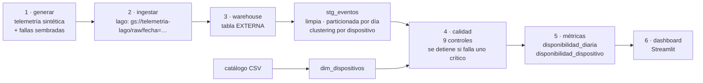

# Proyecto final · Telemetría de dispositivos, de punta a punta

[← Módulo 7](modulo-07-streaming.md) · [Índice](../../README.md) · [Apéndice GCP →](apendice-gcp.md)

> **En una frase:** juntas todo lo aprendido en un pipeline completo (ingesta, lago, warehouse, calidad, métricas y dashboard) que responde una pregunta real de negocio.

**Tiempo estimado:** 2 a 3 semanas para tu propio proyecto · **Ejemplo de referencia:** [`laboratorios/proyecto-final-telemetria`](../../laboratorios/proyecto-final-telemetria/README.md) · **Clasificación:** 🟡 adaptado a local

---

## 1. Qué pide el curso oficial

El proyecto del curso consiste en construir un pipeline de datos **de punta a punta** con un conjunto de datos que elijas tú. **No se permiten los datos de taxis de Nueva York.** Lo revisan 3 compañeros con una rúbrica en la que cada criterio vale 0, 2 o 4 puntos:

| Criterio | Qué se evalúa | En este ejemplo local |
|---|---|---|
| Descripción del problema | Que se entienda qué resuelve | ✅ Sección 2 |
| Nube | Correr en la nube; con infraestructura como código (Terraform) suma más | 🟡 Emulada con LocalCloud. Para puntaje completo hay que desplegar en GCP ([apéndice](apendice-gcp.md)) |
| Ingesta batch u streaming | DAG orquestado que sube datos al lago | 🟡 Pasos en orden con `pipeline.py`; orquestarlo con Kestra queda como mejora (sección 8) |
| Data warehouse | Tablas particionadas y con clustering, con explicación | ✅ `stg_eventos` y `disponibilidad_diaria` |
| Transformaciones | SQL simple o, mejor, dbt/Spark | 🟡 SQL en BigQuery; llevarlo a dbt es una mejora |
| Dashboard | Al menos 2 gráficos: uno por categoría y uno en el tiempo | ✅ Streamlit con ambos |
| Reproducibilidad | Instrucciones claras y código que funciona | ✅ README, semilla fija y pruebas |

Criterios completos y entrega: [README de proyectos](https://github.com/DataTalksClub/data-engineering-zoomcamp/blob/a66ad5da2598d7ac147b37eec29632c93f4b1d9d/projects/README.md) · [Proyecto cohorte 2026](https://github.com/DataTalksClub/data-engineering-zoomcamp/blob/a66ad5da2598d7ac147b37eec29632c93f4b1d9d/cohorts/2026/project.md) · [Video sobre cómo hacer el proyecto](https://www.youtube.com/watch?v=BL0E8xO8OnE)

> ⚠️ **Úsalo como referencia, no como entrega.** El curso considera plagio entregar un proyecto copiado y lo califica con 0. Toma la estructura y las ideas, pero elige **tu propio** problema y tus propios datos.

## 2. El problema del ejemplo

Una empresa tiene **12 dispositivos** en **3 sitios**: gateways, sensores de temperatura de cámaras de frío y medidores de energía. Cada dispositivo envía un **latido** (*heartbeat*) cada 5 minutos. Operaciones necesita responder:

1. ¿Qué dispositivos **no cumplen** el objetivo de **99 % de disponibilidad**?
2. ¿Cómo evoluciona la disponibilidad de cada sitio **día a día**?
3. ¿Podemos **confiar** en los datos? ¿Llegan duplicados, incompletos o con fechas imposibles?

### ¿Qué es "disponibilidad"?

Es el porcentaje del tiempo en que un dispositivo **estaba funcionando y reportando**. Lo medimos así:

```text
                   intervalos de 5 min con al menos un latido "no error"
disponibilidad =  ───────────────────────────────────────────────────────  × 100
                         intervalos esperados (288 por día)
```

Un día tiene 24 × 60 / 5 = **288** intervalos. Si un dispositivo se apaga 6 horas, pierde 72 intervalos y su disponibilidad del día baja a 75 %.

## 3. Arquitectura



| Pieza | Herramienta | Módulo donde se aprendió |
|---|---|---|
| Lago de datos | Cloud Storage (LocalCloud) | 3 |
| Warehouse | BigQuery (LocalCloud) | 3 |
| Tabla externa, partición y clustering | BigQuery SQL | 3 |
| Controles de calidad | SQL + Python | 4 y 5 (pruebas de dbt y controles de Bruin) |
| Ejecución en orden | `telemetria/pipeline.py` | 2 (idea de orquestación) |
| Dashboard | Streamlit + Altair | Nuevo en este proyecto |

## 4. Decisiones de diseño, explicadas

**¿Por qué fallas sembradas?** Un proyecto con datos perfectos no demuestra nada. El generador introduce a propósito:

- caídas: DSP-004 se apaga 6 horas y DSP-012 deja de reportar el último día y medio;
- conexión inestable: DSP-009;
- errores: DSP-007 reporta estado `error` durante 3 horas;
- problemas de calidad: duplicados, eventos sin dispositivo, temperaturas imposibles (999 °C) y fechas en el futuro.

Así puedes **comprobar** que el pipeline los detecta.

**¿Por qué el lago se particiona por carpeta de fecha?** `raw/fecha=2026-11-01/` permite reprocesar un solo día y es la convención que entienden BigQuery, Spark y DuckDB.

**¿Por qué una tabla externa y luego una interna?** La externa permite **mirar** los datos crudos sin copiarlos. La interna (`stg_eventos`) guarda la versión **limpia y optimizada**, la que usan las métricas.

**¿Por qué particionar por día y hacer clustering por dispositivo?** Las preguntas del negocio filtran por **rango de fechas** ("la última semana") y por **dispositivo o sitio**.

**¿Por qué la temperatura imposible no elimina el latido?** El dispositivo **sí** reportó: está disponible. Solo su medición es inválida, así que se deja en `NULL`. Separar "¿llegó la señal?" de "¿el dato es correcto?" es una decisión clave.

**¿Por qué el pipeline se detiene ante fallas críticas?** Es mejor un dashboard **desactualizado** que uno **equivocado**. Las advertencias, en cambio, se registran y se muestran, pero no detienen nada.

### Los 9 controles de calidad

| Control | Severidad | Qué verifica |
|---|---|---|
| `hay_datos_crudos` | crítico | Que llegaron datos |
| `pct_filas_descartadas` | crítico | Que se descarta menos del 5 % |
| `staging_sin_duplicados` | crítico | Un evento, una fila |
| `staging_dispositivo_no_nulo` | crítico | Todos los eventos tienen dispositivo |
| `staging_dispositivo_en_catalogo` | crítico | El dispositivo existe en el catálogo (integridad referencial) |
| `estado_valores_permitidos` | crítico | Solo `ok`, `degradado` o `error` |
| `raw_duplicados` | advertencia | Cuántos duplicados venían en lo crudo (informativo) |
| `raw_temperatura_fuera_de_rango` | advertencia | Cuántas temperaturas imposibles llegaron |
| `dispositivos_sin_datos_ultimo_dia` | advertencia | Dispositivos "mudos" el último día |

## 5. Cómo ejecutarlo

Ver el [README del proyecto](../../laboratorios/proyecto-final-telemetria/README.md):

```bash
docker compose -f laboratorios/localcloud/docker-compose.yml up -d --wait
cd laboratorios/proyecto-final-telemetria
./ejecutar_proyecto.sh
uv run streamlit run dashboard/app.py
```

## 6. Qué resultado esperar

- 23 624 eventos crudos → 23 484 limpios. Se descartan 140: 105 duplicados, 21 sin dispositivo y 14 con fecha futura.
- 6 controles críticos OK y una **alerta**: DSP-012 sin datos el último día.
- Disponibilidad global de **96,92 %**. No cumplen el objetivo DSP-012 (78,27 %), DSP-009 (91,47 %), DSP-004 (96,23 %) y DSP-007 (98,16 %).
- `pytest`: `3 passed`.
- Dashboard en <http://localhost:8501> con 4 indicadores, barras por dispositivo con línea de objetivo, serie diaria por sitio y tablas de detalle y calidad.

**Pregunta para pensar:** ¿por qué los dispositivos "sanos" tienen entre 5 y 20 minutos sin señal? Pista: mira qué filas descarta el paso `warehouse`.

## 7. Cómo comprobarlo

1. `uv run --group dev pytest -q`: una prueba corre el pipeline completo contra LocalCloud y verifica exactamente qué dispositivos incumplen.
2. **Haz fallar el pipeline a propósito:** en `telemetria/config.py`, cambia `MAX_PCT_DESCARTADAS = 5.0` por `0.5` y ejecuta `uv run python -m telemetria.pipeline calidad metricas`. Debe terminar con `EL PIPELINE SE DETUVO` (código 2) **sin** calcular métricas. Después vuelve el valor a 5.0.

## 8. Mejoras sugeridas

Si usas este ejemplo como punto de partida para practicar, estas mejoras suben su puntaje según la rúbrica:

1. **Orquestación con Kestra:** crea un flujo en el [laboratorio del módulo 2](modulo-02-kestra.md) con un `Schedule` diario que ejecute cada paso. Desde el contenedor de Kestra, LocalCloud se alcanza en `http://host.docker.internal:5388`. Ojo: `conexion.py` solo acepta `localhost`, así que tendrías que agregar ese host a la lista permitida. *No probado en esta ruta.*
2. **Transformaciones con dbt:** mueve el SQL de `pasos.py` a modelos dbt con pruebas, como en el [módulo 4](modulo-04-dbt-duckdb.md).
3. **Ingesta en streaming:** publica los latidos en Redpanda y calcula la disponibilidad con ventanas de Flink, como en el [módulo 7](modulo-07-streaming.md).
4. **Nube real e infraestructura como código:** despliega el bucket y el dataset con Terraform en GCP ([apéndice](apendice-gcp.md)).
5. **Alertas:** envía un aviso cuando un dispositivo baje del objetivo.

## 9. Ejercicio original: tu propio SLO

1. Agrega a la tabla `disponibilidad_dispositivo` una columna `minutos_permitidos_semana`: cuántos minutos sin servicio permite el objetivo de 99 % en 7 días. Luego agrega `presupuesto_restante_min`, que es la diferencia con los minutos realmente perdidos. Este concepto se llama **presupuesto de error** (*error budget*).
2. Muestra ese presupuesto en el dashboard como un gráfico de barras.
3. ¿Qué dispositivo **agotó** su presupuesto primero? ¿En qué día?

<details>
<summary>Ver pistas</summary>

- 7 días × 288 intervalos × 5 minutos = 10 080 minutos. Con un objetivo de 99 % se permite fallar el 1 %, es decir, **100,8 minutos** por semana.
- Los minutos perdidos se calculan como `(intervalos_esperados - intervalos_operativos) * 5`, sumados por dispositivo desde `disponibilidad_diaria`.
- Para la pregunta 3, usa una suma acumulada por día: `SUM(...) OVER (PARTITION BY dispositivo_id ORDER BY dia)`.

</details>

## 10. Cómo armar tu propio proyecto

1. **Elige un problema que te interese** y busca datos públicos. Por ejemplo: datos abiertos de tu país (transporte, clima, calidad del aire), APIs públicas o [conjuntos sugeridos por el curso](https://github.com/DataTalksClub/data-engineering-zoomcamp/blob/a66ad5da2598d7ac147b37eec29632c93f4b1d9d/projects/datasets.md).
2. **Escribe la pregunta** que tu dashboard va a responder **antes** de escribir código.
3. Dibuja la arquitectura, como en la sección 3.
4. Empieza con lo mínimo de punta a punta, aunque sea feo, y después mejora cada pieza.
5. Escribe el README pensando en alguien que nunca vio tu proyecto: es el criterio de **reproducibilidad**.

[← Módulo 7](modulo-07-streaming.md) · [Índice](../../README.md) · [Apéndice GCP →](apendice-gcp.md)
