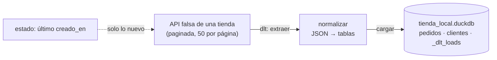

# Taller · Ingesta de datos con `dlt`

[← Módulo 2](modulo-02-kestra.md) · [Índice](../../README.md) · [Módulo 3 →](modulo-03-data-warehouse-bigquery.md)

> **En una frase:** aprendes a traer datos desde una API (un servicio web que entrega datos) hasta una base de datos, sin escribir a mano todo el código repetitivo, y a cargar **solo lo nuevo** en cada ejecución.

**Tiempo estimado:** 2 horas · **Laboratorio:** [`laboratorios/taller-dlt`](../../laboratorios/taller-dlt/README.md) · **Clasificación:** 🟢 local sin cambios

---

## 1. ¿Qué problema resuelve este taller?

Casi todas las empresas sacan datos de **APIs**: la tienda online, el CRM o el sistema de pagos. Escribir un script que las lea parece fácil, pero aparecen detalles muy rápido:

- La API entrega los datos **de a páginas** (50 pedidos por página) y hay que pedir página tras página.
- Los datos vienen en **JSON anidado** (un pedido trae dentro su dirección de envío) y una tabla necesita columnas planas.
- Las columnas **cambian con el tiempo**: un día aparece un campo nuevo.
- No quieres volver a cargar **todo** cada día, solo lo nuevo.
- Si la carga se corta a la mitad, no quieres datos duplicados ni perdidos.

[`dlt`](https://dlthub.com/docs) (*data load tool*) es una librería de Python que resuelve todo eso. Tú escribes **de dónde** vienen los datos y `dlt` se encarga de **cómo** cargarlos.

## 2. Conceptos clave

### Fuente, recurso, pipeline y destino

| Concepto | Qué es | En el laboratorio |
|---|---|---|
| **Recurso** (`@dlt.resource`) | Una función que entrega datos, por ejemplo con `yield` | `pedidos` y `clientes` |
| **Fuente** (`@dlt.source`) | Un grupo de recursos que vienen del mismo lugar | La "API" de la tienda inventada |
| **Destino** | Dónde quedan los datos | DuckDB, una base de datos en un archivo |
| **Pipeline** | Lo que conecta la fuente con el destino y guarda el estado | `tienda_local` |

### Extraer, normalizar, cargar

Cuando llamas `pipeline.run(...)`, `dlt` hace tres etapas:

1. **Extraer:** llama tus funciones y guarda lo que entregan.
2. **Normalizar:** convierte el JSON anidado en tablas planas. El campo `envio: {ciudad, express}` se convierte en las columnas `envio__ciudad` y `envio__express`, y los tipos de datos se infieren solos.
3. **Cargar:** escribe en el destino y registra la carga en la tabla `_dlt_loads`.

### Modos de escritura (`write_disposition`)

| Modo | Qué hace | Cuándo usarlo |
|---|---|---|
| `replace` | Borra la tabla y la vuelve a llenar | Tablas chicas que cambian completas, como `clientes` |
| `append` | Agrega filas al final | Registros que nunca cambian, como logs. Ojo: si repites la carga, duplicas |
| `merge` | Inserta lo nuevo y actualiza lo existente según una clave primaria | Datos que pueden llegar repetidos o corregidos, como `pedidos` |

### Carga incremental

En vez de pedir **todos** los pedidos cada vez, `dlt` recuerda el **último valor** de una columna, por ejemplo `creado_en`, y en la siguiente ejecución pide solo los pedidos posteriores. Esa "memoria" se llama **estado** y `dlt` la guarda tanto en la carpeta `.dlt_pipelines/` como dentro de la base de datos.

```python
@dlt.resource(primary_key="pedido_id", write_disposition="merge")
def pedidos(creado_en=dlt.sources.incremental("creado_en")):
    yield from api.pedidos(desde=creado_en.last_value)
```

### DuckDB

[DuckDB](https://duckdb.org/) es una base de datos analítica que vive en **un solo archivo**, sin servidor. Es como SQLite, pero pensada para analizar datos. Se usa mucho para practicar y prototipar, y reaparece en los módulos 4 y 5.

## 3. Qué vas a construir



La API es una función de Python que **imita** a una API real, así que no necesitas internet ni credenciales.

## 4. Cómo ejecutarlo

Pasos completos en el [README del laboratorio](../../laboratorios/taller-dlt/README.md):

```bash
cd laboratorios/taller-dlt
uv sync
uv run python pipeline.py --dias 3
uv run python pipeline.py --dias 5
uv run python pipeline.py --dias 5
uv run python consultar.py
```

La idea es simular el paso del tiempo: primero "existen" 3 días de pedidos, después 5, y luego se repite la ejecución sin pedidos nuevos.

## 5. Qué resultado esperar

| Ejecución | Pedidos cargados | Por qué |
|---|---|---|
| `--dias 3` | 360 | Primera vez: carga todo lo que existe |
| `--dias 5` | 240 | Solo los días 4 y 5: incremental |
| `--dias 5` otra vez | 0 | No hay nada nuevo |
| **Total en la tabla** | **600**, sin duplicados | |

## 6. Cómo comprobarlo

`uv run python consultar.py` muestra:

- el total (600) y el rango de fechas, de `2024-01-01 00:00` a `2024-01-05 23:48` UTC;
- que hay **0 duplicados**;
- las columnas aplanadas `envio__ciudad` y `envio__express`;
- **3 filas** en `_dlt_loads`, una por ejecución.

## 7. Ejercicio original: cuando la fuente cambia

1. Agrega un campo nuevo `descuento` (entre 0 y 0,3) a cada pedido de la API falsa y ejecuta con `--dias 6`. ¿Qué hace `dlt` con la columna nueva? ¿Qué valor tienen los pedidos antiguos en esa columna?
2. Cambia `pedidos` a `write_disposition="append"`, borra el estado (mira "Volver a empezar de cero" en el README) y ejecuta **dos veces** con `--dias 3`, pero quitando el incremental. ¿Cuántas filas hay? ¿Por qué con `merge` no pasaba?
3. Explica con tus palabras para qué sirve la `primary_key` en `merge`.

<details>
<summary>Ver solución</summary>

1. `dlt` detecta la columna nueva y la **agrega** a la tabla. A esto se le llama *evolución del esquema*. Los pedidos cargados antes quedan con `NULL` en `descuento`.
2. Con `append` sin incremental, la segunda ejecución vuelve a insertar los 360 pedidos y quedan **720 filas, con duplicados**. Con `merge`, `dlt` usa la clave primaria para **reemplazar** la fila existente en vez de agregar otra.
3. Es la columna, o columnas, que identifica de forma única cada registro. `merge` la usa para saber si un pedido "ya existe" y debe actualizarse, o si es nuevo y debe insertarse.

</details>

## 8. Clasificación de los ejercicios oficiales

[Tarea oficial del taller 2026](https://github.com/DataTalksClub/data-engineering-zoomcamp/blob/a66ad5da2598d7ac147b37eec29632c93f4b1d9d/cohorts/2026/workshops/dlt/dlt_homework.md): construir un pipeline desde una API paginada de viajes de taxi hacia DuckDB.

| Parte oficial | Clasificación | Nota |
|---|---|---|
| Pipeline desde la API paginada hacia DuckDB | 🟢 Local sin cambios | Necesita internet para llamar a la API pública del curso, pero no requiere GCP |
| Preguntas sobre fechas, pagos con tarjeta y propinas | 🟢 Local sin cambios | Se responden con SQL sobre DuckDB, como en `consultar.py` |
| Construcción asistida con IA (MCP de dlt, IDE con agente) | 🟢 Local sin cambios | Opcional; depende de tu editor |
| Notebook `DLT_upload_to_GCP.ipynb` del módulo 3 | 🔴 Requiere GCP | Para cargar a un bucket local, usa el patrón del [laboratorio del módulo 3](modulo-03-data-warehouse-bigquery.md) |

## 9. Material oficial (en inglés)

- [Video del taller de dlt 2026](https://www.youtube.com/watch?v=5eMytPBgmVs)
- [README del taller (versión 2026)](https://github.com/DataTalksClub/data-engineering-zoomcamp/blob/a66ad5da2598d7ac147b37eec29632c93f4b1d9d/cohorts/2026/workshops/dlt/README.md)
- [Taller de ingesta asistida con IA](https://github.com/DataTalksClub/data-engineering-zoomcamp/blob/a66ad5da2598d7ac147b37eec29632c93f4b1d9d/cohorts/2026/workshops/dlt.md)
- [Documentación de dlt](https://dlthub.com/docs)

## 10. Errores frecuentes

| Mensaje | Qué hacer |
|---|---|
| `Ambiguous reference to catalog or schema` | El archivo `.duckdb` se llama igual que el dataset; cambia uno de los dos nombres |
| `Pending packages are left in the pipeline` | Una carga quedó a medias. Mira "Problemas frecuentes" en el README del laboratorio |
| Siempre carga 0 pedidos | El estado recuerda la última fecha. Para reiniciar, borra el `.duckdb` **y** `.dlt_pipelines/` |
| Las horas aparecen corridas | DuckDB usa la zona horaria de tu Mac al mostrar; usa `SET TimeZone = 'UTC'` |

[← Módulo 2](modulo-02-kestra.md) · [Índice](../../README.md) · [Módulo 3 →](modulo-03-data-warehouse-bigquery.md)
